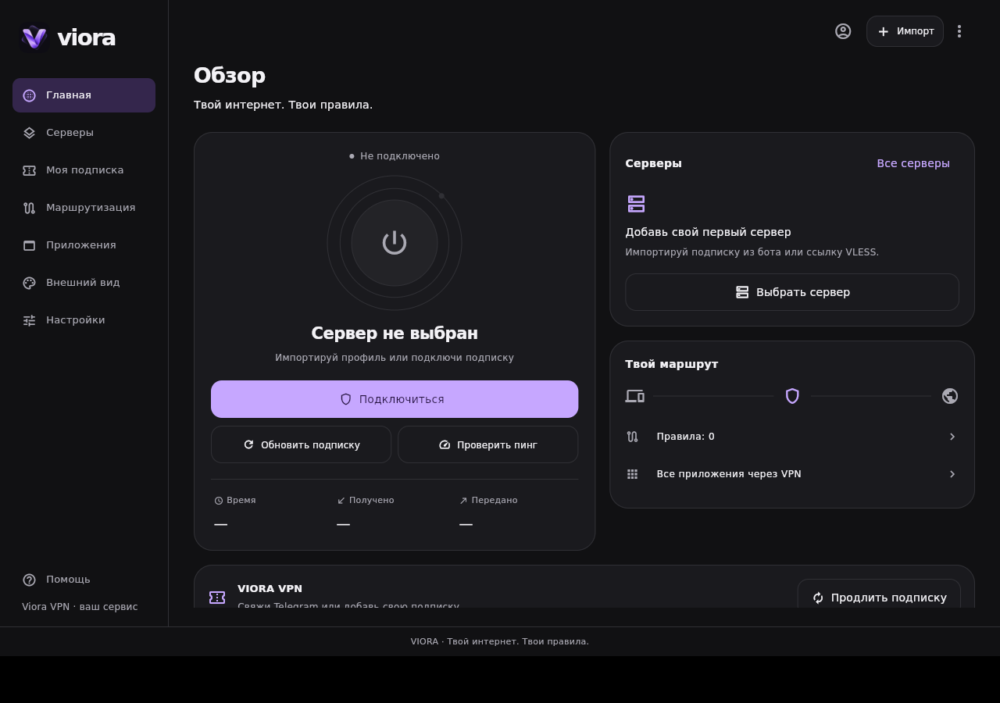

# VIORA Linux 1.0.5 (35)

Linux-версия использует актуальный Flutter-интерфейс Windows 1.0.5:
состояния подключения, анимации, серверы, подписки, приложения и административный
кабинет. Существующие аккаунты, настройки и HWID сохраняются.

Сетевой модуль адаптирован к Linux: sing-box 1.14.4-viora.1 управляет системным TUN,
а Xray обслуживает VLESS через локальный SOCKS с временным паролем. Это отдельные
проверяемые компоненты, конфигурация с секретами передаётся через stdin.
Windows Wintun/WFP не переносятся. Постоянная защита Linux использует nftables
и существующий ранний systemd unit.

Форматы выпуска: DEB для Debian/Ubuntu, RPM для Fedora и pacman-пакет для Arch.
Они содержат один комплект Linux x86_64, собранный на Ubuntu 22.04, а не три
отдельные сборки в целевых дистрибутивах. Пакеты включают полный текст GPL,
уведомление upstream, закреплённый архив исходников sing-box, опубликованный
Linux overlay, его regression tests и сборщик. Linux-компонент собирается
из исходников с исправлением поиска процесса после переподключений;
официальный Windows binary остаётся прежним.

При упаковке и проверке не устанавливаются программы и не включается VPN.
Проверка сравнивает все байты полезной нагрузки, режимы доступа, владельцев,
метаданные зависимостей и безопасное поведение установочных сценариев.
Успешное выполнение этих проверок не доказывает реальную передачу трафика
или отсутствие DNS/IPv6/WebRTC-утечек. Фактические результаты текущей сборки
нужно читать в итоговом отчёте, включая непроверенные сценарии.

Установка, обновление и восстановление интернета описаны в
[инструкции Linux 1.0.5](linux-install-variants-1.0.5.md).
Происхождение нового TUN-компонента — в
[описании sing-box](linux-sing-box-provenance-1.0.5.md).
Пакеты без подписи издателя; SHA-256 прилагается.

## Фактически выполненные проверки 29.10.2026

Проверки выполнялись в отдельной Ubuntu 22.04 QEMU VM с ядром 5.15.
Сеть Windows и подключение Happ не переключались. Использован локальный
VLESS WS TLS сервер, DNS и HTTPS endpoint внутри тестового namespace;
данные и подписки пользователей не использовались. TLS проверялся с временным
CA только в гостевой системе. После теста CA, интерфейсы, маршруты, процессы
и тестовая блокировка удалены, исходный обычный интернет VM восстановлен.

- Flutter: **195 PASS, 15 SKIP**, анализатор без замечаний; Release 1.0.5+35
  собран и запущен. Пропуски относятся к условиям платформы и optional capture.
- Go helper в Linux: **161 PASS**, включая подтесты, без пропусков; конфигурации
  проверены реальными Xray и sing-box CLI без создания VPN в этих unit cases.
  Windows Go tests и `go vet` обеих платформ также прошли.
- Поправка sing-box: **9 PASS**, включая подтесты, в настоящем пакете `route`;
  данные интерфейсов подставляются, сеть этими unit tests не меняется.
- Изолированная сетевая проверка: **26 PASS** на финальных бинарниках.
  Проверены DNS, HTTPS по имени и первый HTTPS по IP без DNS приложений,
  реальные счётчики upload/download, all/only/except и фактическое различие
  прямого/проксируемого соединения, блокировка IPv6 в тестовом маршруте.
  Проверены SIGKILL frontend, очистка правил, повторное подключение, запрет
  исключённой программы и работа разрешённой в строгом режиме, сохранение ON
  после остановки, реальный запрет IP-трафика без TUN, подключение поверх
  уже включённой блокировки и возврат прямого соединения после явного recovery.
- Предварительные проверки упаковщика: **8 отрицательных сценариев PASS**.
- Конечные **DEB/RPM/Arch PASS**: сверены 45 файлов полезной нагрузки в каждом
  формате, их SHA-256, права, владельцы, зависимости и сценарии удаления.
  Встроенные хеши помощника совпадают с фактическими Xray и sing-box.
- В Ubuntu VM проверены **установка → удаление → повторная установка DEB**.
  Установленная версия — 1.0.5 amd64, команда запуска и polkit policy входят
  в пакет и удаляются штатно; хеши установленных UI и сетевых компонентов
  совпадают с протестированными файлами. Защита после установки остаётся OFF.

Рядом с пакетами предоставляются `Viora-Linux-1.0.5-test-results.json`,
`Viora-Linux-1.0.5-variants-verification.json` и `SHA256SUMS-Linux-1.0.5.txt`.
Первый содержит результаты изолированного сетевого теста и хеши компонентов,
второй — результаты проверки содержимого установочных пакетов.

Результат подтвердил и позволил исправить промах кэша локальных интерфейсов,
асинхронную готовность systemd-resolved, остаточные правила после аварии и
числовую сериализацию nftables 1.0.2. Определение неизвестного процесса остаётся
закрытым: соединение блокируется, а не получает произвольный маршрут.

| Файл | SHA-256 |
| --- | --- |
| `viora_tunnel` | `34207ab7a0d1da7cb813ca4d9f41898151518d30aca73dbbfe82d957621c4574` |
| `core/xray` | `ecdf0735c7226c1f8e0851d40d042b3f6e0d2e150cfe8b18b731b3838f0ad3e3` |
| `core/sing-box` | `c555912d5dfe2a1dc541666bf4c404a13a7630a711898ceb1a7482e07b0b4032` |
| `viora_client` | `8e6b774ae1cb55d3c4336bd3a9b7eef7f5edf7e9fbaae98aaa505b58939a9d6d` |
| `lib/libapp.so` | `5668e3e88821b90c3ae1a421c86655532576ae5d0b6b9241ba5a35bb09ca6b36` |

Использованы `flutter-development`, `go-development`, `security-review`,
`software-quality` и `git-and-project-flow`. Реальные субагенты выполняли
перенос сетевого модуля, независимое ревью защиты/упаковки и Linux UI QA;
сборка, интеграция и реальные проверки VM выполнялись главным агентом.

## Границы проверки

Не проверены пользовательский удалённый VPN-сервер и личный аккаунт,
установка/работа в Fedora и Arch, suspend/resume, перезагрузка с включённой
постоянной защитой, длительная сессия и браузерный WebRTC. Сетевая проверка
локального fixture и unit tests не доказывают отсутствие всех утечек или
полную безопасность. Проект CI дополнен сборкой и регрессией Linux frontend;
новый удалённый запуск GitHub Actions в этой работе не выполнялся.

## Интерфейс собранного приложения

Чистый профиль, настоящее Linux Release-приложение в виртуальном дисплее:

